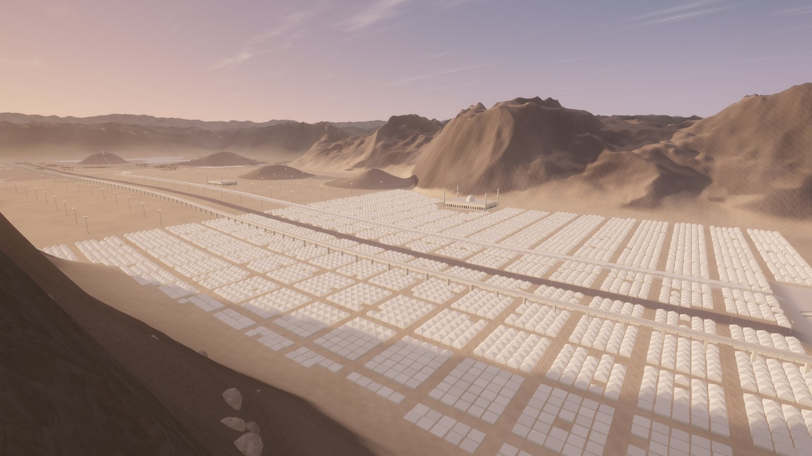
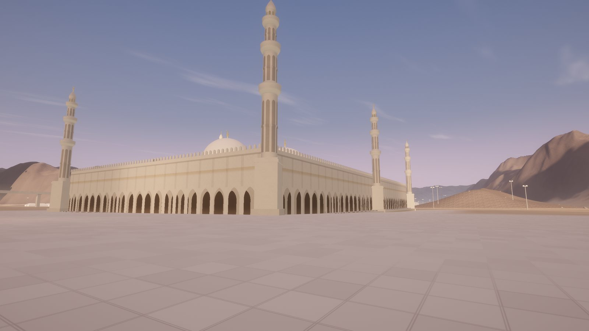
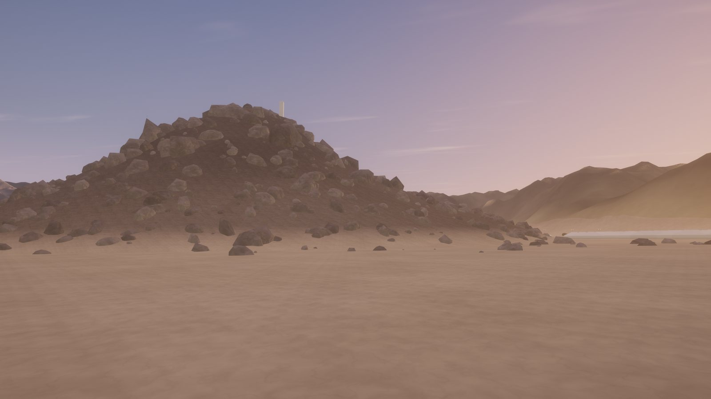
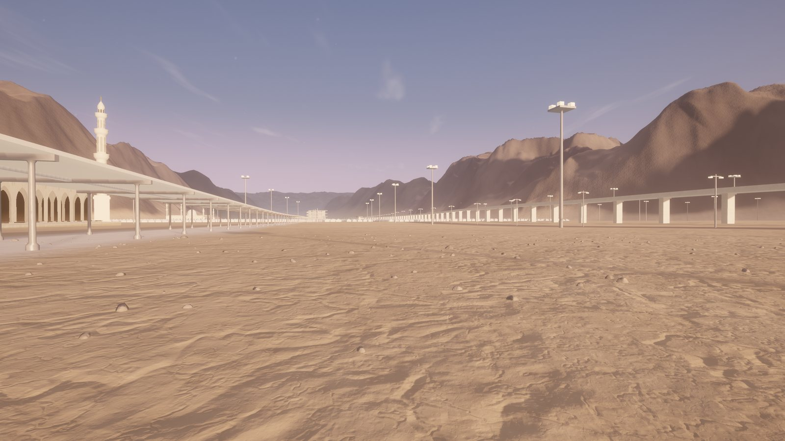
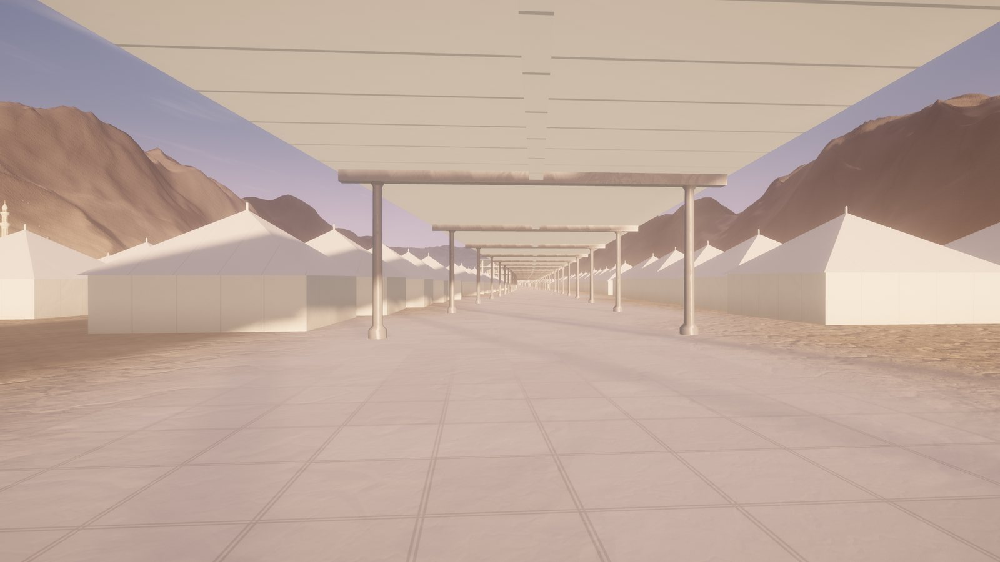
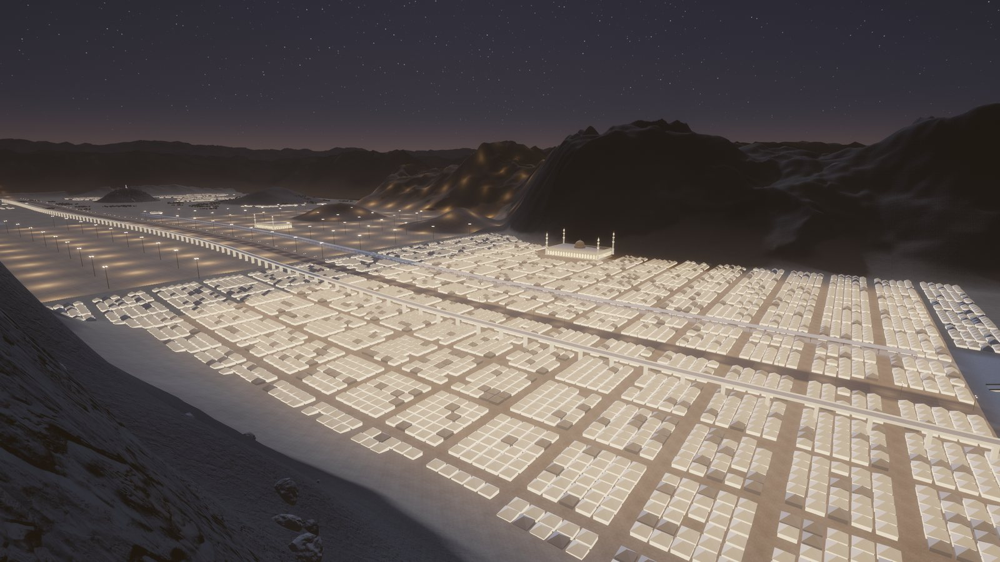
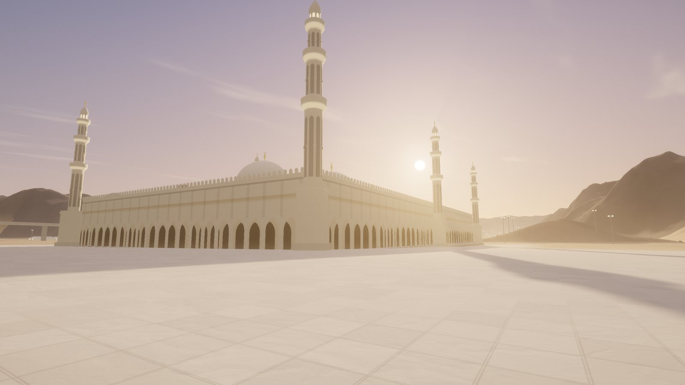
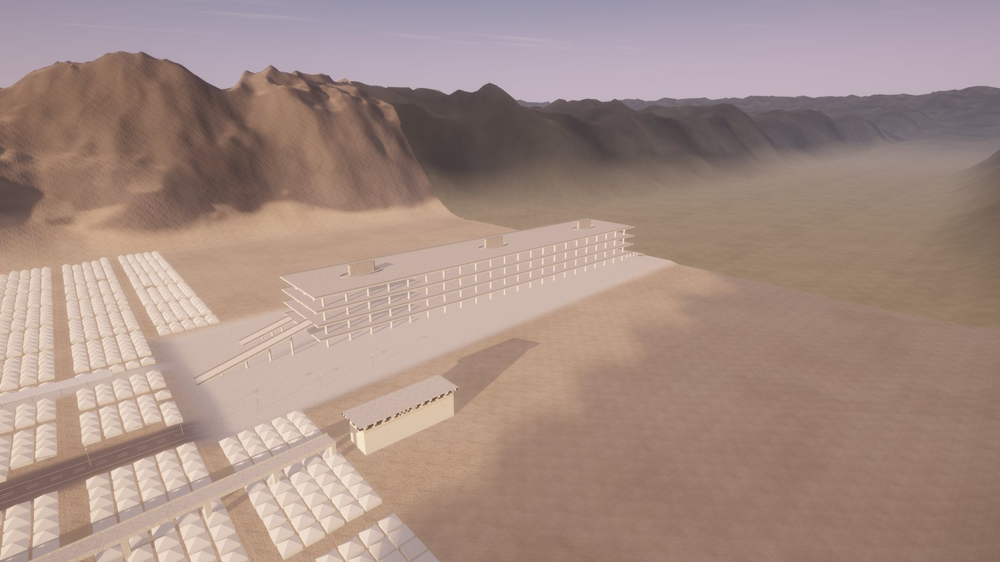

# Hajj Route

<p align="center">
  <a href="https://moeymakes.github.io/makkah-hajj-route/"></a>
</p>
<p align="center"><b><a href="https://moeymakes.github.io/makkah-hajj-route/">moeymakes.github.io/makkah-hajj-route/</a></b><br>
<sub>Chrome or Edge on a desktop or laptop (needs WebGPU) · nothing to install · one HTML file</sub></p>

**Walk and fly the Hajj route east of Makkah, right in your browser: Mina's valley of white tents, the Namirah
mosque and Jabal al-Rahmah on the plain of Arafat, Muzdalifah's open plain, and the Jamarat, at dawn, golden hour
or night.**

Thousands of white peaked tents fill a valley between bare granite mountains; a highway, a covered walkway and an
elevated rail line run east to Muzdalifah's gravel plain with its tall light towers; on Arafat, groves of neem trees
stand round a low granite hill with a white pillar on its summit, and the Namirah mosque with its six minarets and
three domes stands at the plain's western edge. Everything is made by code: no images, no 3D models, no sound files.
The whole world is **one HTML file** of about 79 KB (33 KB gzipped).

The buildings are respectful approximations, not replicas, and the geography is composed: the real route is some
15-20 km long and here it is about 4 km, so a short flight takes you along all of it. The spaces are empty: there
are no people, nothing inside any building is shown, and nothing is recited or written.

[](https://moeymakes.github.io/makkah-hajj-route/)

| | |
|---|---|
|  |  |
|  |  |
|  |  |



## Try it

1. Open **[https://moeymakes.github.io/makkah-hajj-route/](https://moeymakes.github.io/makkah-hajj-route/)** in
   **Chrome** or **Edge** on a desktop computer, or download [`index.html`](index.html) and open it from your
   computer (it works offline).
2. Wait a moment while the valley is built, pick a **Time** if you like, then press **Enter**. Keys `1` to `6` follow
   the route in order; `F` lets you fly.

It needs a browser with **WebGPU**.

## The six viewpoints, in order

1. **Mina** from the slope above the tents, looking up the valley into the morning light
2. **The Namirah mosque** at the western edge of Arafat
3. **Jabal al-Rahmah**, its granite boulders and the white pillar on the summit
4. **Muzdalifah**: the open plain, the light towers, the walkway and the rail line
5. **The covered walkway** leading back into Mina's tents
6. **The Jamarat** from the air, beside the tent valley

## Controls

| | Keyboard & mouse |
|---|---|
| Look around | Move the mouse (or drag with the left button where the mouse cannot be captured) |
| Walk | `W` `A` `S` `D` |
| Run | Hold `Shift` |
| Fly / walk | `F`, or `E` to lift off from walking |
| Up / down | `E` / `Q` (descending onto the ground lands you back to walking) |
| Jump to a viewpoint | `1` to `6` |
| Menu | `Esc` |
| Sound on / off | `M` |
| Performance stats | `H` |
| Time of day | **Dawn**, **Golden hour** or **Night** in the menu (reloads the page) |
| Sound | **Valley**, **Wind**, **Birds**, **Calm** or **Off**, and a volume slider, in the menu |
| Detail level | **Low**, **Medium** or **High** in the menu (reloads the page) |

**On a touchscreen:** hold one finger down to walk forward and slide it to look around; a second finger runs;
the ✈ button toggles flight.

## How it works

- The land is one function evaluated on the graphics card twice: a 5 m grid over the route and a coarser grid out
  to 12 km. It also marks where the granite, the roads, the paving, the tents and the trees go.
- The mountains' shadows are baked once from that grid; a shadow map that follows you adds the shadows of tents,
  posts, rocks and buildings near you.
- Tents, rocks, trees, posts and lamps are instanced from a handful of meshes; the Jamarat, the mosques, the walkway
  and the rail line are built from boxes, lathes and sweeps when the page opens.
- The time of day is chosen before the world is built, so each look costs nothing extra while you walk.
- Everything is drawn with **WebGPU** directly. No engine or 3D library.
- The method, the verification loop and the page structure follow
  [Abyssal Garden](https://github.com/noniv/abyssal-garden) (MIT), via the `worldsmith` skill, by way of the sibling
  worlds Makkah Haram, Nabawi Courtyard and Madinah Horizon.

## Make it your own

Source is in [`source`](source). Rebuild with Node.js 18+:

```bash
cd source && npm install && npm run build
```

| File | What's inside |
|---|---|
| [`source/src/world.js`](source/src/world.js) | Layout and time-of-day presets: tents, the Jamarat, mosques, Jabal al-Rahmah, roads, walkway, rail line, towers, trees, viewpoints and the camera path |
| [`source/src/shaders.js`](source/src/shaders.js) | The land function, sky and haze, ground, stone, fabric and tree materials, lamps, sun shafts and the final image |
| [`source/src/main.js`](source/src/main.js) | Renderer, the following shadow map, walking and flying, collision, controls, the Time and Detail menus |
| [`source/src/audio.js`](source/src/audio.js) | The soundscape and the Sound menu |
| [`source/src/quality.js`](source/src/quality.js) | Detail levels and the stored time of day |
| [`source/template.html`](source/template.html) | The page: loading bar, menu, controls list |

`npm run build:dev` writes `dev.html` with a scripted one-minute flight (`P`) and a benchmark (`B`).

## Other worlds in this series

- **[Makkah Haram](https://moeymakes.github.io/makkah-haram/)**: the Mataf round the Kaaba in Masjid al-Haram ([source](https://github.com/moeymakes/makkah-haram))
- **[Madinah Horizon](https://moeymakes.github.io/madinah-horizon/)**: the date gardens, lava fields and hills around Madinah at golden hour ([source](https://github.com/moeymakes/madinah-horizon))
- **[Nabawi Courtyard](https://moeymakes.github.io/masjid-nabawi-courtyard/)**: the marble plaza of the Prophet's Mosque as the great umbrellas open ([source](https://github.com/moeymakes/masjid-nabawi-courtyard))
- **[Madinah, First Years](https://moeymakes.github.io/madinah-first-years/)**: the oasis and the first mosque around 622-632 CE, an artistic reconstruction ([source](https://github.com/moeymakes/madinah-first-years))

## License

MIT. Parts adapted from Abyssal Garden (MIT); its notice is in `source/LICENSE-abyssal-garden`.
